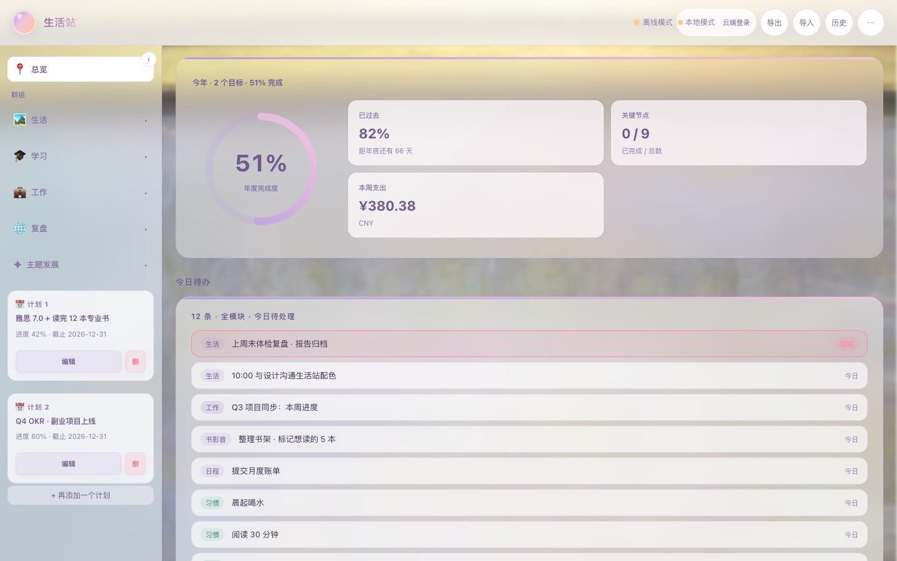
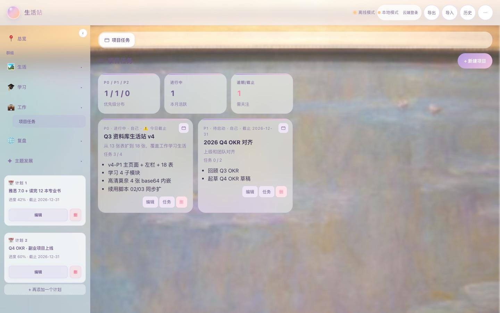
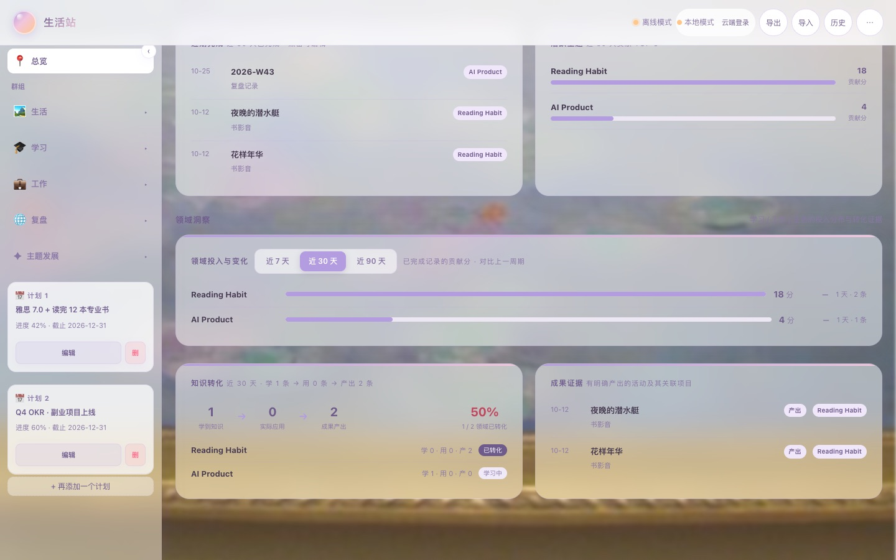
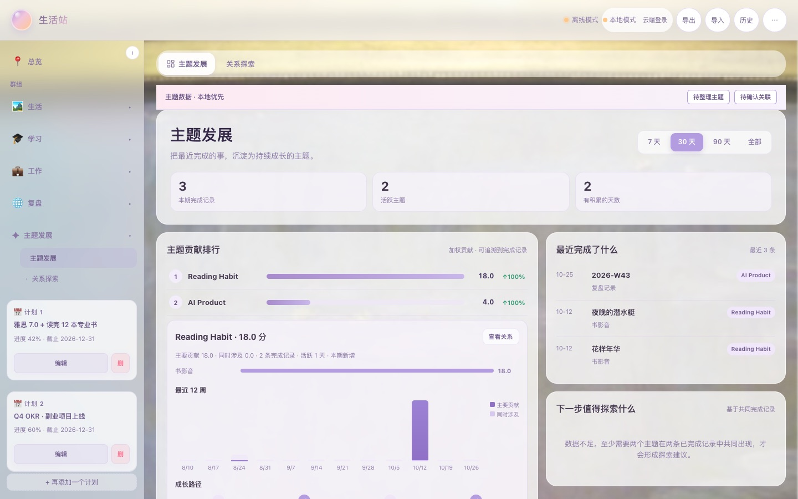

# LifeStation · 生活站

> A single-file personal workspace that grows into a **lifelong growth database** —
> 每一条完成的任务、习惯打卡与笔记，都会沉淀为可分析、可回溯的成长证据。


**Live Demo · 在线演示**: <https://4e02747cedc7482d94dcddbc44e8af01.app.workbuddy.link/>

*By default all data stays in your own browser's localStorage — the demo starts empty and
private. Cloud sync is optional: only when you actively sign in are the supported tables
(currently `topics`, in a phased rollout) uploaded. 默认情况下数据只保存在你本机浏览器的
localStorage 中，演示空白、天然私密；只有当你主动登录云端同步时，支持范围内的数据
（目前仅 `topics`，分阶段接入）才会被上传。*



---

## What is this · 这是什么

Most to-do apps stop at "task done ✅". LifeStation goes further: it records daily
execution (tasks, habits, projects, courses, reading) and continuously turns that raw
activity into a **contribution-weighted growth model**, so it can answer the questions
a checklist never could:

- Which **domains** am I actually investing in — and how is that shifting week by week?
- Of all the things I **learn**, which ones later get **applied and reused**?
- What **evidence of progress** can I point to, beyond a raw count of finished tasks?

大多数待办应用止步于「任务完成 ✅」。生活站把日常执行记录持续沉淀为**按贡献加权的成长模型**，
回答清单类工具回答不了的问题：我的投入分布在哪、学到的东西有没有被真正用起来、
我能拿出哪些看得见的「进展证据」。

---

## Features · 核心功能

### 🏠 All-in-one workspace · 一体化工作台

**EN** — 21 local tables: 18 business tables across 4 groups — life (todos, calendar,
habit check-ins with 30-day heatmaps, fitness with 7-day moving average & BMI,
multi-currency bookkeeping, books/movies/music), learning (course notes, daily study
tasks, yearly goals, study check-ins, study notes), work (projects with inline task
lists), and review (weekly reviews, Inbox) — plus 3 topic-analysis tables (`topics`,
`topic_events`, `knowledge_links`). A cross-module "Today" board aggregates everything
due right now — click any item to open its source record for editing.

**中文** — 底层共 21 张本地数据表：18 张业务表覆盖生活（待办 / 日程 / 习惯打卡+30 天热力图 /
健身+7 日均线+BMI / 多币种记账 / 书影音）、学习（课程笔记 / 每日学习任务 / 学习目标 / 学习打卡 / 学习复盘）、
工作（项目任务+内嵌清单勾选）、复盘（每周复盘 / Inbox）；另有 3 张主题分析表（`topics`、`topic_events`、`knowledge_links`）。
「今日待办」跨模块聚合所有当下该处理的事，点击条目即可直接打开来源记录进行编辑。

| Learning · 学习 | Work · 工作 |
|---|---|
|  |  |

### 🌱 Topic growth system · 主题成长系统

**EN** — A finished record that is linked to a **topic** (and has growth-counting
enabled) feeds an explainable contribution model:

```
contribution = record-type weight × topic-role weight × stage weight
```

Six evidence stages give "learning" a real lifecycle:
`E1 Explore → E2 Learn → E3 Synthesize → E4 Apply → E5 Output → E6 Reuse`.
Any task/habit/note can reference existing plans, projects, or courses — child records
then *inherit* their parents' topics automatically. Auto-generated junk topics are
quarantined behind an `_auto` flag and triaged in a dedicated review panel.

**中文** — 完成记录在关联主题且启用「计入成长」后，才会进入可追溯的主题贡献统计，用可解释的公式计分
（记录类型权重 × 主题角色权重 × 阶段权重）。习惯只计算实际打卡，不计习惯定义本身。
E1–E6 六个阶段给「学习」以完整生命周期：探索 → 学习 → 综合 → 应用 → 产出 → 复用。
任务/打卡/笔记可结构化关联到计划、项目、课程，子记录自动继承父级主题；
标题不会自动变成主题——机器生成的候选主题会被 `_auto` 标记隔离，在专门的治理面板中人工裁决。

### 📊 Insight boards · 分析看板

**EN** — The dashboard opens with three evidence-first boards: **Domain Overview**
(contribution per topic over 7/30/90 days with period-over-period change),
**Knowledge Conversion** (a per-topic stage overview: which topics show learning,
application, and output records this period — a co-occurrence signal, not a strict
causal funnel), and **Output Records** (finished activities classified into the
output/reuse stages, shown with their linked project when one exists). A dedicated
Observatory page adds a 12-week contribution histogram, a four-step growth path, and a
relation explorer backed by actually shared records.

**中文** — 主页三大看板：**领域投入与变化**（7/30/90 天贡献分 + 环比）、**知识转化**
（按主题汇总本周期出现的学习 / 应用 / 产出记录，反映阶段共现、帮助发现哪些主题已从学习延伸到实践，而非严格因果转化链）、**产出记录**
（集中展示被归入「产出 / 复用」阶段的已完成活动，存在结构化关联时显示所属项目）。另有「主题发展」页：12 周贡献柱状图、四步成长路径、基于真实共同记录的关系探索。





---

## Getting Started · 快速开始

**Option 1 — Online demo（在线体验，最快）**
Open the [live demo](https://4e02747cedc7482d94dcddbc44e8af01.app.workbuddy.link/),
click **⋯ → 加载示例数据** to fill it with realistic sample data, and explore.

> ⚠️ 加载示例数据会覆盖当前浏览器中已有的生活站数据；请在空白浏览器环境体验，或先执行导出备份。

**Option 2 — Local single file（本地单文件）**
Download [`src/生活站.html`](src/生活站.html) and double-click it. No install, no build,
no server, no network — it works fully offline in Safari / Chrome / Firefox.
On iPhone, open it in Safari and use *Share → Add to Home Screen* to run it like an app.

**Your data（数据与备份）**
By default everything is stored in your browser's localStorage. Use **导出 / 导入**
(top-right) to back up and restore as JSON. Nothing leaves your device unless you
actively sign in to cloud sync (which currently covers only the `topics` table).

---

## Engineering · 工程特点

- **One self-contained HTML file** — no build step, no framework, no runtime dependency
  for the local app; Monet's public-domain paintings are inlined as compressed
  backgrounds (~1.2 MB total). Optional cloud sync loads the Supabase client on demand,
  and a few test suites use jsdom.
- **Dual storage stack** — localStorage by default, with a silent-write sync layer
  designed for optional cloud backends
- **14 test suites · 489 checks** — the app logic (aggregation, topic inheritance,
  migration, routing) is extracted from the HTML and regression-tested in Node `vm` +
  jsdom on every change; the single-file architecture doesn't mean "untestable"
- **Real bugs found and fixed by the test harness** — a DST-transition timing bug in the
  habit heatmap (date comparison drifted on clock-change days), a seed-data type bug that
  silently broke the dashboard (a `Date` object leaking into string-only date fields),
  duplicate legacy-code shadowing, and seed-migration traps (substring-only title matching)

---

## Repository layout · 仓库结构

```
lifestation/
├── README.md                  # you are here · 当前文档
├── LICENSE                    # MIT
├── src/
│   └── 生活站.html             # the whole app, one file · 整个应用（单文件）
├── deploy/
│   └── index.html             # deployed copy · 部署副本
├── scripts/                   # 14 regression suites + screenshot tooling · 回归测试与截图脚本
└── docs/                      # design docs & guides · 设计文档与使用指南
```

## Running tests · 运行测试

```bash
node scripts/v2j_growth_stage_test.js      # most suites use only Node.js
# jsdom-based suites additionally need: NODE_PATH=<path-to>/node_modules
```

Every suite extracts the relevant functions out of the HTML source, runs them in a
Node `vm` sandbox against fixtures, and asserts on both static structure and behavior.

每套测试从 HTML 源码中抽取相关函数，在 Node `vm` 沙箱中针对 fixture 运行，
同时断言静态结构与运行行为——单文件架构不等于「不可测试」。

---

## Design principles · 设计原则

1. **Evidence over vanity metrics** · 证据优先于虚荣指标 — a finished task only counts once it maps to a topic, a stage, and (where possible) a project
2. **Anti-pollution by default** · 默认防污染 — titles never auto-become topics; new topics require explicit confirmation
3. **Single source of truth per concept** · 每个概念只有一个事实源 — one contribution model, one stage vocabulary, one linking schema
4. **Boring tech, obsessive polish** · 技术从简、打磨入微 — vanilla JS, one file, but with audit trails, migration flags, and idempotent upgrades

---

## License

MIT. Artwork: Claude Monet paintings (public domain · 公共领域作品).
